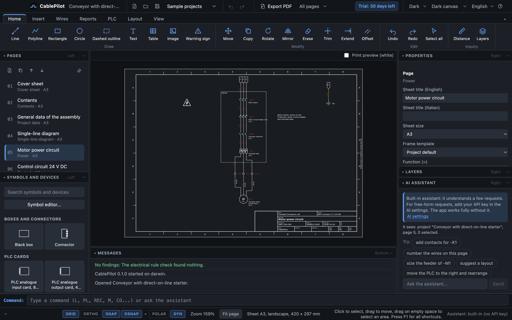

<p align="center">
  <picture>
    <source media="(prefers-color-scheme: dark)" srcset="docs/logo-dark.svg">
    
  </picture>
</p>

<p align="center"><b>Draw the schematic once. Terminals, cables, BOM and cabinet follow.</b><br>Source-available electrical CAD for machine builders, control-panel builders and system integrators: multi-page IEC schematics, live terminal, cable and wire lists, PLC I/O and BOM, a cabinet layout in 2D and 3D, and production drawing sets in your own title block.<br>English and Italian · macOS, Windows and Linux · runs offline, no account · every feature free for 30 days.</p>

<p align="center">
  <a href="https://github.com/mojeee/cablepilot/releases/latest"></a>
  <a href="https://github.com/mojeee/cablepilot/actions/workflows/ci.yml"></a>
  <a href="LICENSE.md"></a>
  <a href="library/LICENSE"></a>
  
  
  <a href="https://cablepilot.agentflowbind.com/docs/"></a>
</p>

<p align="center">
  <a href="https://cablepilot.agentflowbind.com"><b>Website</b></a> ·
  <a href="https://cablepilot.agentflowbind.com/#videos">Short videos</a> ·
  <a href="https://cablepilot.agentflowbind.com/demo/">Two-minute demo</a> ·
  <a href="https://cablepilot.agentflowbind.com/docs/getting-started/"><b>Getting started</b></a> ·
  <a href="docs/README.md">Docs</a> ·
  <a href="https://github.com/mojeee/cablepilot/discussions">Discussions</a>
</p>



<p align="center"><sub>If CablePilot saves you an evening of typing terminal lists, a ⭐ helps other panel builders find it.</sub></p>

## Why CablePilot

Electrical departments draw the same information many times: the schematic, then the terminal plan, the cable list,
the wire list, the BOM, the cabinet layout, and a drawing set for the customer. CablePilot keeps **one source of
truth, the schematic**, and generates everything else from it, live. Change a device in one place and every list,
cross-reference and drawing follows.

- **Standards, with sources.** IEC 60617 symbols, IEC 81346 designations, IEC 61082 documents, IEC 60204-1, cable
  sizing to IEC 60364-5-52, IEC 61439 assemblies. Every rule and table value cites its clause; values not yet verified
  are listed openly in [docs/to-verify.md](docs/to-verify.md).
- **Your files stay yours.** One documented JSON file per project that diffs well in Git; PDF, DXF, CSV and XLSX out,
  DXF in. No account, no cloud, no lock-in.
- **Honest, optional AI.** Bring your own Claude, OpenAI or Gemini key. Every change it proposes is a preview you
  accept or reject; every claim shows its source; electrical values are labelled as suggestions. The app is fully
  usable without it.

## Features

| Area | What you get |
|---|---|
| Schematic | Multi-page projects, IEC symbols, automatic designations, orthogonal wires with junctions, potentials, single-line and multi-line pages, black boxes and connectors, macros, a symbol editor |
| Devices | A coil and its contacts as one device, contact images, cross-references (`8.3` or `08-E3`), parts from the library, nested assemblies |
| Wires and reports | Wire numbering by potential, page and column, sequence or rung; terminal diagrams, cable, wire and pin lists, BOM, legends, nameplates, markers, all live |
| Checks and revisions | A continuous electrical rule check with one-click fixes; issued revisions, a generated cover sheet and revision comparison |
| PLC | Racks and cards as devices, addresses by your scheme, an I/O overview, tag lists for TIA Portal and CODESYS |
| Sizing and warehouse | Breakers, contactors, overload relays and cables sized from the schematic, proposed from your own stock list |
| CAD workspace | Ribbon, command line with the usual aliases, typed coordinates, object snaps, window and crossing selection, layers |
| Cabinet layout | Devices at real size on DIN rails and ducts, a suggested layout, dimensions, side view, duct fill, wire lengths, 3D view, drilling DXF |
| Panel Designer tools | Insert a symbol on a wire to split it, auto-wire, ladder pages (NFPA 79 style), project history with daily backups |
| ERP link | Items and stock over REST or OData, pick parts from the warehouse, send reservation requests back ([docs/erp-link.md](docs/erp-link.md)) |
| Drawing set | Cover sheet with sheet index and revisions, data sheets, legends, terminal and cable pages, layout, BOM, in your frame and title block, as a vector PDF |

Three complete sample projects ship with the app (a conveyor, a pump station and a 110 V DC battery charger), so every
feature can be tried without your own drawings. See them in the [short videos](https://cablepilot.agentflowbind.com/#videos).

## Install

The first release is being prepared. When it is out, download the file for your computer from the
[latest release](https://github.com/mojeee/cablepilot/releases/latest):

| Computer | File |
|---|---|
| Mac with Apple Silicon | `CablePilot-mac-arm64.dmg` |
| Mac with Intel | `CablePilot-mac-x64.dmg` |
| Windows 10 or 11 (64-bit) | `CablePilot-win-x64.exe` |
| Linux (64-bit) | `CablePilot-linux-x86_64.AppImage` |

The builds are not signed yet: on a Mac open the app the first time with right-click > Open; on Windows choose More
info > Run anyway. Until then, run it from source (below). Then follow [Getting started](docs/getting-started.md).

Every feature is free for 30 days on each computer, with no account. After the trial CablePilot asks for a licence
key (`CP1-…`), one per user or seat: see [Pricing](https://cablepilot.agentflowbind.com/#pricing) (prices are not set
yet; request a key in [GitHub Discussions](https://github.com/mojeee/cablepilot/discussions)). Your projects and
exports stay yours and stay readable without a key.

## Run from source

```bash
npm install
npm run dev
```

| Command | What it does |
|---|---|
| `npm run typecheck` | Strict TypeScript for main, preload and renderer |
| `npm test` | Unit tests (Vitest): connectivity, numbering, reports, checks, file format, i18n, ERP, AI tools |
| `npm run test:e2e` | Builds the app and drives it with Playwright, one test per workflow |
| `npm run check:licenses` | Lists every dependency's licence; fails on GPL or AGPL |
| `npm run check:library` | Every file under `library/` has its source and required fields |
| `npm run dist` | Packages the app for this computer into `dist/` (electron-builder) |
| `npm run build:site` | Regenerates the website in `site/` from the docs, the roadmap and the library |

Releases are built by [.github/workflows/release.yml](.github/workflows/release.yml) when a `v*` tag is pushed.

## Documentation

- [Getting started](docs/getting-started.md) · [How numbering works](docs/numbering.md) · [Project file format](docs/file-format.md)
- [ERP link](docs/erp-link.md) · [Cabinet layout exchange](docs/layout-format.md) · [Demo walkthrough](docs/demo.md)
- For contributors: [brief](docs/brief.md), [roadmap](docs/roadmap.md), [decisions](docs/decisions.md),
  [progress](docs/progress.md), [values to verify](docs/to-verify.md), [website](docs/website.md). All in [docs/](docs/README.md).

## Contribute in 30 minutes

1. Fork the repository and run `npm install` and `npm run dev` (5 minutes).
2. Pick something small:
   - fix or add an Italian text in `shared/i18n/it/` (the test in `tests/i18n.test.ts` tells you which are missing);
   - add a library data file under `library/` with its `source` and run `npm run check:library`;
   - add a unit test for a function in `shared/`;
   - improve a text in `scripts/site/texts.mjs` and run `npm run build:site`.
3. Run `npm run typecheck && npm test` (2 minutes).
4. Commit and open a pull request. By contributing you agree to the contribution terms in
   [LICENSE.md](LICENSE.md) section 7 (see [CONTRIBUTING.md](CONTRIBUTING.md)). Issues labelled `good first issue`
   are a good place to start.

Questions, training and custom features for companies: [GitHub Discussions](https://github.com/mojeee/cablepilot/discussions)
and the [page for companies](https://cablepilot.agentflowbind.com/companies/).

## Status

Milestones M0 to M7 and the first two parts of M8 are done (see [docs/roadmap.md](docs/roadmap.md) and
[docs/progress.md](docs/progress.md)). Release 1 is next: installers, the end-to-end tests of every workflow and the
launch checklist. Phase 2 adds electronics (KiCad file formats).

## Folders

`app/main` (Electron main), `app/preload` (typed API), `app/renderer` (UI), `shared` (model, connectivity, file
format, reports, checks, i18n), `library` (symbols, parts, macros as data), `samples`, `docs`, `site` (the generated
website), `scripts`, `tests`, `e2e`, `build` (app icon).

## Licence

CablePilot is **source-available**, not open source: the code is public so you can read it, check what it does with
your drawings, build it and contribute.

| What | Licence |
|---|---|
| The app (this repository, except below) | [CablePilot License 1.0](LICENSE.md): source-available, free 30-day trial with every feature, then a licence key |
| `library/` (symbols, parts, terminals, cables, frames, title blocks, macros as data) | [CC BY 4.0](library/LICENSE) |
| `shared/fonts/` | [SIL Open Font License 1.1](shared/fonts/LICENSE.txt) |
| Your drawings | Yours: open JSON format and PDF, DXF, CSV and XLSX exports, usable without the app and after the trial |

Versions up to commit `01271c2` were released under the Apache License 2.0 and keep that licence. Copyright Mojtaba
Amini; see also [NOTICE](NOTICE). Third-party licences are listed in `THIRD_PARTY_LICENSES.md`, generated at build
time.
